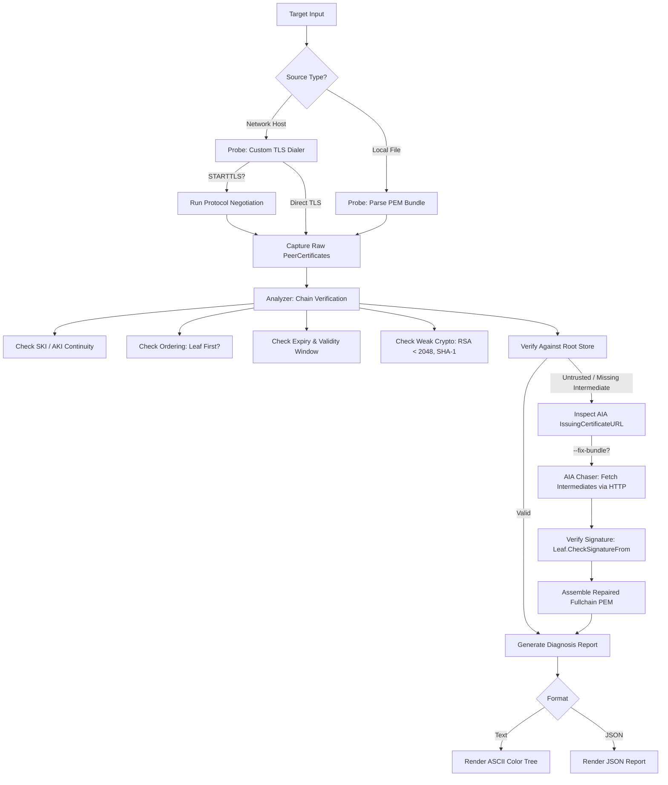

# Architecture & Design

`cert-chain-doctor` is designed as a standalone, zero-dependency, zero-CGO tool that leverages Go's standard library `crypto/tls` and `crypto/x509` engines.

---

## Package Structure

```text
cmd/cert-chain-doctor/
  ├── main.go        # CLI argument parsing, execution pipeline, exit codes, and HTTP serve mode
  └── main_test.go   # Integration tests against local TLS servers and offline bundle files

internal/
  ├── probe/         # Custom crypto/tls dialer and STARTTLS protocol drivers
  ├── analyzer/      # X.509 chain continuity, SKI/AKI verification, and CA/B Forum validation
  ├── aia/           # Authority Information Access HTTP fetcher (DER/PEM/PKCS#7) & bundle repairer
  ├── render/        # Visual ASCII tree diagram, ANSI color engine, and K8s Secret generator
  ├── revocation/    # Active OCSP responder and CRL distribution reachability verifier
  └── testpki/       # In-memory PKI generator and httptest AIA server for deterministic unit testing
```

---

## Diagnostic Pipeline



---

## Authority Information Access (AIA) Chasing

RFC 5280 defines the Authority Information Access extension (OID `1.3.6.1.5.5.7.1.1`). Certificate Authorities encode HTTP URLs where their issuing CA certificates can be downloaded:

```text
X509v3 Authority Information Access:
  CA Issuers - URI:http://cacerts.digicert.com/DigiCertGlobalG2TLSRSASHA2562020CA1-1.crt
```

When an intermediate certificate is missing from the server handshake, `cert-chain-doctor`:
1. Extracts `cert.IssuingCertificateURL`.
2. Downloads the certificate over HTTP using standard timeouts.
3. Decodes the response, supporting single DER certificates, multi-certificate DER blocks, RFC 7468 PEM blocks, and PKCS#7 (`.p7b` / `.p7c`) signed data bags.
4. Cryptographically verifies that the retrieved candidate certificate actually signed the child certificate using `child.CheckSignatureFrom(candidate)`.
5. Iteratively repeats up to 5 hops if multi-level intermediates are chained.
6. Automatically omits redundant Root CAs (per RFC 8446) and writes a pristine PEM bundle.
