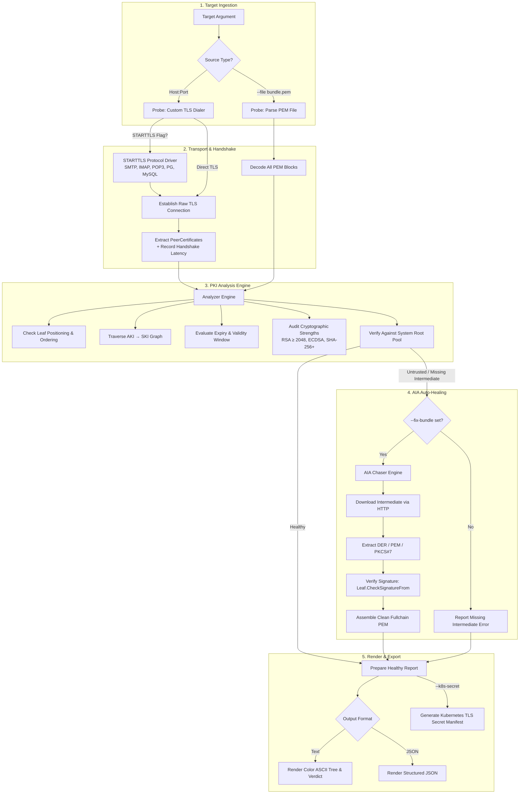
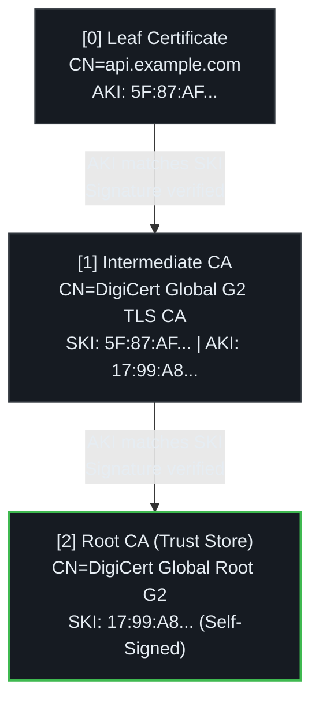
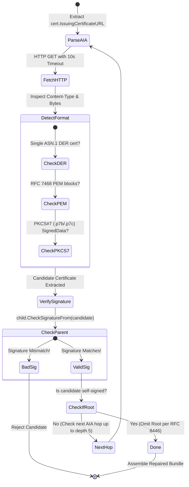

# Architecture & PKI Engine

`cert-chain-doctor` is engineered as a zero-dependency, zero-CGO diagnostic tool and automated chain repair utility. It relies entirely on Go's standard library `crypto/tls` and `crypto/x509` engines, ensuring cross-platform portability and memory safety without linking against external C libraries such as OpenSSL.

---

## Architectural Principles

1. **Zero CGO:** Built with `CGO_ENABLED=0`. Produces a completely static binary that runs without glibc or OpenSSL dependencies across Alpine Linux, minimal scratch containers, macOS, and Windows.
2. **Deterministic Cryptographic Verification:** Chain validation strictly enforces RFC 5280 and CA/Browser Forum Baseline Requirements. It directly evaluates cryptographic signatures using public keys rather than relying on cached platform state.
3. **Safe AIA Chasing:** Downloads intermediate certificates via Authority Information Access URLs with bounded timeouts, size limits, format auto-detection (DER, PEM, PKCS#7), and cycle detection.
4. **Non-Destructive Repairs:** Always validates that a candidate intermediate certificate successfully signed the child certificate (`child.CheckSignatureFrom(candidate)`) before writing output files.

---

## High-Level Diagnostic Pipeline

The diagram below illustrates how `cert-chain-doctor` processes targets from network dial or offline file through to diagnostic verdicts:



---

## Package Breakdown

```text
cmd/cert-chain-doctor/
  ├── main.go        # CLI argument parsing, workflow execution, exit codes, and HTTP serve mode
  └── main_test.go   # Integration tests against local TLS servers and offline bundle files

internal/
  ├── probe/         # Custom crypto/tls dialer, ALPN handling, and STARTTLS protocol state machines
  ├── analyzer/      # X.509 chain continuity, SKI/AKI verification, and CA/B Forum validation
  ├── aia/           # Authority Information Access HTTP fetcher (DER/PEM/PKCS#7) & bundle repairer
  ├── render/        # Visual ASCII tree diagram, ANSI color engine, and K8s Secret generator
  ├── revocation/    # Active OCSP responder and CRL distribution reachability verifier
  └── testpki/       # In-memory PKI generator and httptest AIA server for deterministic unit testing
```

---

## X.509 Chain Verification & Graph Traversal

A valid X.509 certificate chain is a directed acyclic graph (DAG) where each certificate is signed by the public key of the certificate above it:



### AKI to SKI Matching
1. **Subject Key Identifier (SKI):** A 160-bit SHA-1 hash of the public key extension (RFC 5280 §4.2.1.2) identifying the certificate's unique key.
2. **Authority Key Identifier (AKI):** The key identifier matching the SKI of the issuing CA certificate (RFC 5280 §4.2.1.1).
3. `cert-chain-doctor` extracts the AKI from the child certificate and traverses the presented chain to find the matching SKI. If no certificate matches, it flags `MISSING_INTERMEDIATE`.

---

## Authority Information Access (AIA) Chasing Engine

RFC 5280 §4.2.2.1 specifies the Authority Information Access extension. When an intermediate CA is missing, `cert-chain-doctor` extracts the HTTP URL from the Leaf certificate:

```text
X509v3 Authority Information Access:
  CA Issuers - URI:http://cacerts.digicert.com/DigiCertGlobalG2TLSRSASHA2562020CA1-1.crt
```



### Supported Download Formats
The AIA engine handles multiple response formats commonly served by global CAs:
* **Raw ASN.1 DER:** Standard single binary X.509 certificate (MIME `application/pkix-cert`).
* **Multi-Certificate DER:** Concatenated binary DER structures.
* **RFC 7468 PEM:** Standard ASCII armor blocks (`-----BEGIN CERTIFICATE-----`).
* **PKCS#7 Bags:** Cryptographic Message Syntax (`.p7b` and `.p7c`) signed data containers containing certificate collections (MIME `application/x-pkcs7-certificates`).

---

## Redundant Root CA Handling (RFC 8446)

Section 4.4.2 of the TLS 1.3 specification (RFC 8446) states:
> *"The sender's certificate MUST be contained in the first CertificateEntry... Each following certificate SHOULD directly certify the one immediately preceding it. Because certificate validation requires that the trust anchor be distributed independently, a certificate that specifies a trust anchor MAY be omitted from the chain."*

Including a self-signed Root CA in the server TLS handshake:
* Wastes 1,200 to 2,000 bytes per TLS handshake.
* Triggers additional TCP segments and potential window delays on constrained mobile networks.
* Provides zero cryptographic utility because clients only trust Root CAs installed in their local operating system trust store.

`cert-chain-doctor` detects self-signed roots in the handshake, raises a `REDUNDANT_ROOT_IN_HANDSHAKE` warning, and automatically excludes them when generating repaired bundles with `--fix-bundle`.
