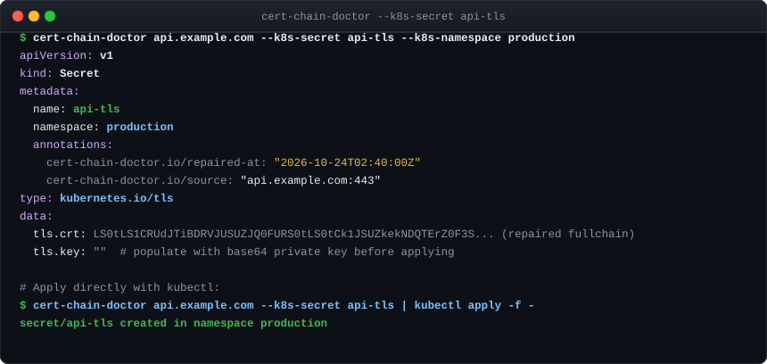
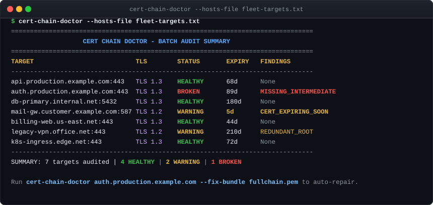

# Worked Examples

This page provides practical, copy-paste recipes for common operational challenges faced by DevOps engineers, SREs, and security teams.

---

## Recipe 1: Fixing "Works in Chrome, Fails in curl" for Nginx or Envoy

### The Problem
Your web application opens cleanly in desktop browsers with a green padlock. However, backend microservices, mobile apps, or command-line scripts fail:

```bash
curl -v https://api.example.com
# Output:
# * SSL certificate problem: unable to get local issuer certificate
# * Closing connection 0
# curl: (60) SSL certificate problem: unable to get local issuer certificate
```

### The Diagnosis
Run `cert-chain-doctor` against the target:

```bash
cert-chain-doctor api.example.com --fix-bundle /etc/nginx/ssl/repaired-fullchain.pem
```

The tool identifies the missing intermediate certificate, automatically chases the CA's AIA URL, verifies the digital signature against your leaf certificate, and produces the complete bundle:


### The Solution: Deploy Repaired Bundle

Update your web server configuration to point to the repaired fullchain bundle:

::: tabs
::: tab Nginx
```nginx
server {
    listen 443 ssl http2;
    server_name api.example.com;

    # Point to the repaired fullchain bundle
    ssl_certificate /etc/nginx/ssl/repaired-fullchain.pem;
    ssl_certificate_key /etc/nginx/ssl/api.example.com.key;

    ssl_protocols TLSv1.2 TLSv1.3;
    ssl_ciphers HIGH:!aNULL:!MD5;
}
```

Test and reload Nginx:
```bash
nginx -t && nginx -s reload
```
::: tab Envoy
```yaml
tls_certificates:
  - certificate_chain:
      filename: "/etc/envoy/ssl/repaired-fullchain.pem"
    private_key:
      filename: "/etc/envoy/ssl/api.example.com.key"
```
::: tab Apache
```apache
<VirtualHost *:443>
    ServerName api.example.com
    SSLEngine on
    SSLCertificateFile /etc/ssl/certs/repaired-fullchain.pem
    SSLCertificateKeyFile /etc/ssl/private/api.example.com.key
</VirtualHost>
```
:::

---

## Recipe 2: Exporting Repaired Chains as Kubernetes Secrets

### The Problem
You need to generate a `kubernetes.io/tls` secret containing a complete, verified certificate chain for an Ingress controller (e.g. Ingress-Nginx, Traefik, or Istio).

### The Solution
Use the `--k8s-secret` and `--k8s-namespace` flags:

```bash
cert-chain-doctor api.example.com \
  --k8s-secret api-tls \
  --k8s-namespace production \
  --fix-bundle /tmp/repaired.pem > k8s-tls-secret.yaml
```

Inspect the terminal preview:



You can apply the secret directly to your Kubernetes cluster in a single pipeline:

```bash
cert-chain-doctor api.example.com \
  --k8s-secret api-tls \
  --k8s-namespace production \
  --fix-bundle /tmp/repaired.pem | kubectl apply -f -
```

Attach the secret to your Ingress resource:

```yaml
apiVersion: networking.k8s.io/v1
kind: Ingress
metadata:
  name: api-ingress
  namespace: production
spec:
  tls:
    - hosts:
        - api.example.com
      secretName: api-tls
  rules:
    - host: api.example.com
      http:
        paths:
          - path: /
            pathType: Prefix
            backend:
              service:
                name: api-service
                port:
                  number: 8080
```

---

## Recipe 3: Fleet-Wide TLS Auditing across Microservices

### The Problem
You are managing dozens or hundreds of internal services and need a fast, non-intrusive audit before a production cutover to ensure no expired certificates or missing intermediates exist across the fleet.

### The Solution
Create a plain-text file listing your targets:

```text
# fleet-targets.txt
api.production.example.com:443
auth.production.example.com:443
db-primary.internal.net:5432
mail-gw.customer.example.com:587
billing-web.us-east.net:443
legacy-vpn.office.net:443
k8s-ingress.edge.net:443
```

Execute a parallel batch audit with `--hosts-file`:

```bash
cert-chain-doctor --hosts-file fleet-targets.txt
```

Resulting audit summary table:



### Scripting with Exit Codes
In a CI/CD job or scheduled cron script, evaluate the exit code to raise alerts:

```bash
#!/usr/bin/env bash
set -e

if ! cert-chain-doctor --hosts-file fleet-targets.txt --expiry-warn 14; then
  echo "CRITICAL: Broken certificate chains or imminent expirations detected across fleet!"
  # Trigger Slack or PagerDuty alert here
  exit 1
fi

echo "Fleet audit passed. All certificate chains healthy."
```

---

## Recipe 4: Pre-Commit & CI Validation of Local PEM Bundles

### The Problem
Preventing developers or automation tools from committing invalid, misordered, or expired `.pem` certificate bundles to Git repositories.

### The Solution
Use `--file` to validate files locally without requiring network access:

```bash
cert-chain-doctor --file ./certs/production-bundle.pem
```

Add this validation step to your GitHub Actions workflow:

```yaml
name: Validate TLS Certificates
on: [pull_request, push]

jobs:
  validate-certs:
    runs-on: ubuntu-latest
    steps:
      - uses: actions/checkout@v4

      - name: Install cert-chain-doctor
        run: |
          curl -sSL https://github.com/smford/cert-chain-doctor/releases/download/v0.1.1/cert-chain-doctor_0.1.1_linux_amd64.tar.gz | tar -xz
          sudo mv cert-chain-doctor /usr/local/bin/

      - name: Audit PEM Bundles
        run: |
          cert-chain-doctor --file ./certs/ingress-bundle.pem
```

If a certificate in `./certs/ingress-bundle.pem` is misordered or expired, the step fails with exit code `1`, halting the pull request.

---

## Recipe 5: Testing Pre-Release Ingress via Direct IP with SNI

### The Problem
You have deployed a new Ingress controller or Cloud Load Balancer at IP `198.51.100.24`, but public DNS for `api.example.com` has not yet been switched. You need to verify that the load balancer serves the correct certificate and SNI negotiation.

### The Solution
Pass the target IP address and provide the intended hostname via `--sni`:

```bash
cert-chain-doctor 198.51.100.24:443 --sni api.example.com
```

This tests the exact TLS handshake that clients will experience after DNS propagates, avoiding temporary `/etc/hosts` modifications.

---

## Recipe 6: Auditing Mail and Database Protocols (STARTTLS)

### The Problem
Services like SMTP mail transfer agents and PostgreSQL databases do not speak TLS immediately on TCP connect. Instead, they begin the conversation in plain text and upgrade to TLS via protocol-specific handshakes.

### The Solution
Use the `--starttls` flag with the target protocol name:

```bash
# SMTP Submission (port 587)
cert-chain-doctor smtp.example.com:587 --starttls smtp

# PostgreSQL Database (port 5432)
cert-chain-doctor db.internal.net:5432 --starttls postgres

# IMAP Mail Server (port 143)
cert-chain-doctor imap.example.com:143 --starttls imap

# POP3 Mail Server (port 110)
cert-chain-doctor pop.example.com:110 --starttls pop3

# MySQL Database (port 3306)
cert-chain-doctor mysql.internal.net:3306 --starttls mysql
```

`cert-chain-doctor` handles the protocol-specific negotiation banner, issues the upgrade command, completes the TLS handshake, and validates the resulting certificate chain.

---

## Recipe 7: Running as an HTTP Diagnostic Microservice

### The Problem
You want to provide self-service certificate diagnosis to internal engineering teams or health check monitoring agents via a REST API.

### The Solution
Launch `cert-chain-doctor` in daemon mode:

```bash
cert-chain-doctor serve --addr :8080
```

Query the `/diagnose` endpoint with any target:

```bash
curl -s "http://localhost:8080/diagnose?target=api.example.com" | jq .
```

Sample JSON response:
```json
{
  "target": "api.example.com",
  "handshake": {
    "server_name": "api.example.com",
    "tls_version": "TLS 1.3",
    "cipher_suite": "TLS_AES_128_GCM_SHA256",
    "handshake_ms": 14
  },
  "analysis": {
    "status": "HEALTHY",
    "issues": []
  }
}
```

Deploy it easily in Kubernetes as a diagnostic sidecar or cluster-wide service.
