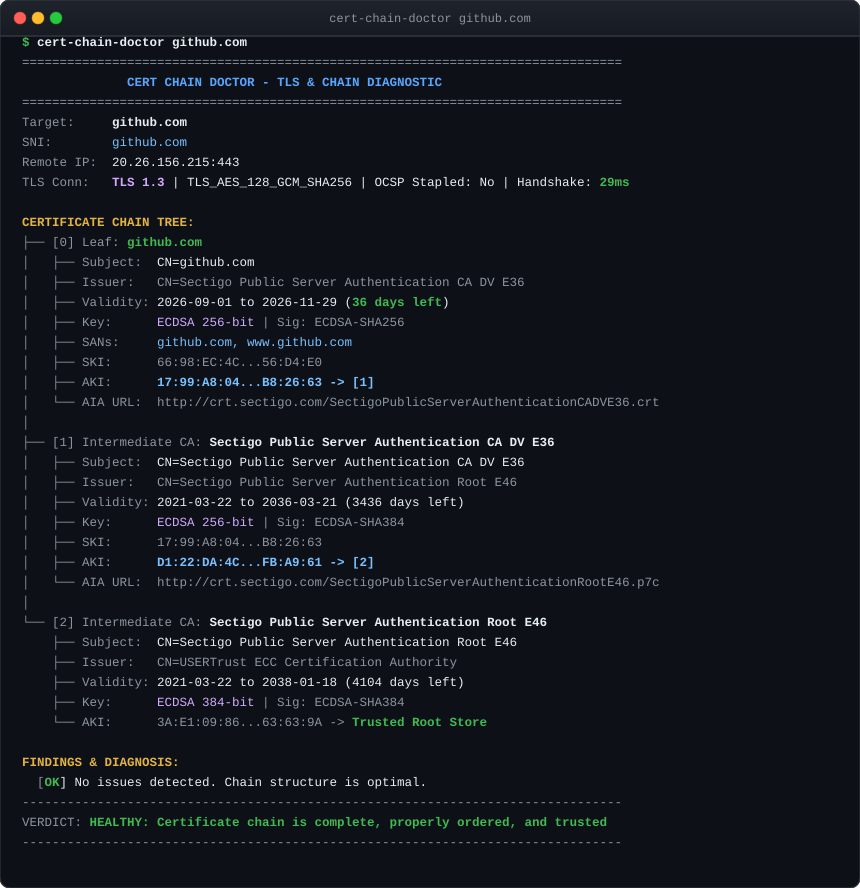
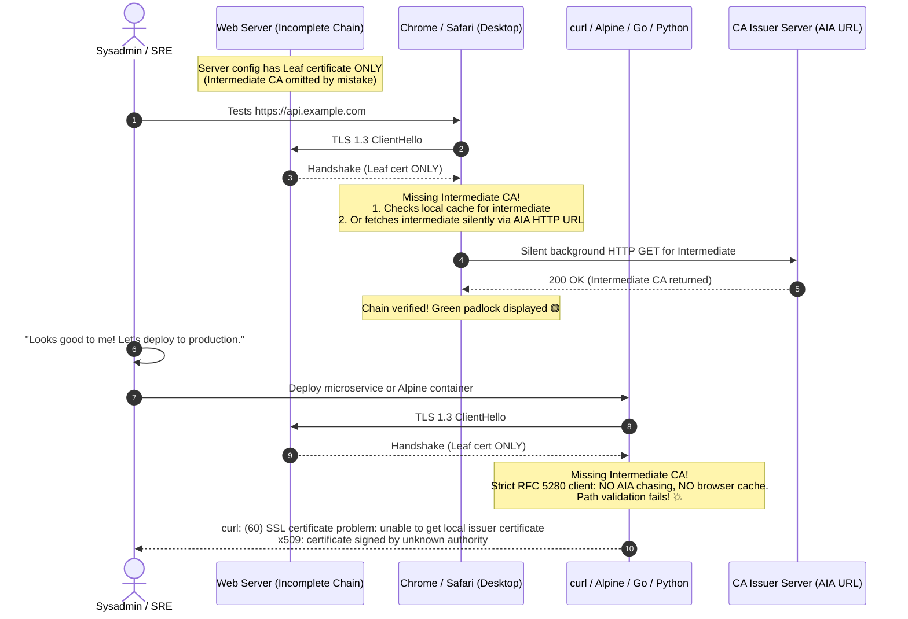
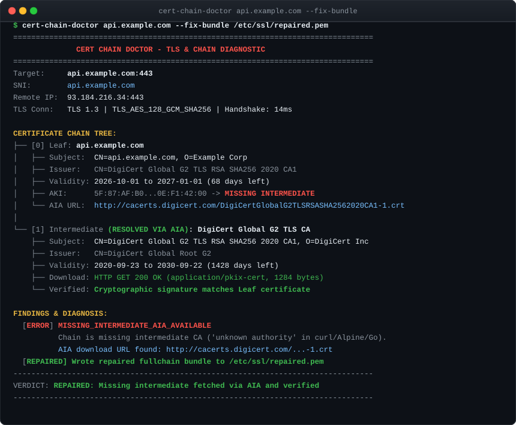

# cert-chain-doctor

[](https://github.com/smford/cert-chain-doctor/actions/workflows/ci.yml)
[](https://github.com/smford/cert-chain-doctor/releases/latest)
[](LICENSE)
[](https://golang.org)
[](#architecture)
[](https://github.com/smford/cert-chain-doctor/actions)

> **The visual diagnostic tool and automatic repair surgeon for broken TLS handshakes and intermediate certificate chains.**

Have you ever encountered an HTTPS endpoint that opens without issues in Google Chrome or Safari, yet immediately crashes in `curl`, Python `requests`, Alpine Docker containers, or Go microservices with `x509: certificate signed by unknown authority`?

`cert-chain-doctor` solves this ubiquitous production outage. It inspects TLS handshakes and X.509 certificate chains, pinpointing missing intermediates, misordered certificates, and redundant roots. When a chain is incomplete, it automatically chases Authority Information Access (AIA) URLs over HTTP to fetch missing intermediates, cryptographically verifies signatures, and outputs a ready-to-deploy `.pem` fullchain bundle for Nginx, Envoy, or Kubernetes.

---

## Live Terminal Inspection

Click on the terminal below to zoom into an interactive inspection:



---

## The Mystery of the Missing Intermediate

Why do broken certificate chains pass desktop browser tests but crash backend production services?



> [!IMPORTANT]
> **Desktop browsers mask broken server configurations.** Chrome and Safari cache intermediate certificates across websites and chase AIA download URLs in the background. Command-line utilities (`curl`), container runtimes (Alpine Linux), and programming languages (Go, Python, Java, Node.js) adhere strictly to RFC 5280 and do **not** chase AIA URLs by default.

---

## Instant Problem & Solution Matrix

| Outage Scenario | Root Cause | Client Error Symptoms | How `cert-chain-doctor` Fixes It |
|:----------------|:-----------|:----------------------|:---------------------------------|
| **Missing Intermediate** | Web server only serves Leaf certificate | `curl: (60) SSL certificate problem`<br/>`x509: certificate signed by unknown authority` | Automatically downloads missing Intermediate via AIA and reassembles a valid fullchain bundle. |
| **Misordered Chain** | Certificates concatenated out of order (e.g. Intermediate before Leaf) | Modern clients drop connection or reject handshake | Analyzes Subject/Issuer and SKI/AKI continuity; automatically sorts Leaf &rarr; Intermediates. |
| **Redundant Root in Handshake** | Self-signed Root CA bundled into server configuration | Handshake bloat (+1.5KB), increased TCP round-trips over mobile | Flags redundant root per RFC 8446 guidelines and strips it from the repaired bundle. |
| **Imminent Expiration** | Certificate expiring within 14 days | Impending service outage | Flags expiration countdown with exit code `2` for automated monitoring and CI alerts. |
| **Hostname Mismatch** | Wildcard cert does not cover multi-level subdomain | `x509: certificate is valid for *.example.com, not sub.dev.example.com` | Lists all SANs and highlights the exact naming mismatch. |

---

## Automatic Repair in Action

When `cert-chain-doctor` detects a missing intermediate, pass `--fix-bundle` to immediately repair the chain:



The tool connects to the CA's issuing server, downloads the intermediate certificate, cryptographically verifies that it signed your leaf certificate (`Leaf.CheckSignatureFrom(Intermediate)`), and writes a clean, production-ready `.pem` file.

---

## Quickstart Scenarios

::: tabs
::: tab Inspect Live Host
Diagnose any public or internal HTTPS endpoint:

```bash
cert-chain-doctor api.example.com
```

You can also specify a custom port or IP address with an SNI override:

```bash
cert-chain-doctor 198.51.100.42:443 --sni api.example.com
```
::: tab Auto-Repair Fullchain
Download missing intermediate certificates and assemble a clean PEM bundle:

```bash
cert-chain-doctor api.example.com --fix-bundle /etc/nginx/ssl/fullchain.pem
```

Deploy the output directly to Nginx, Envoy, or Apache.
::: tab Kubernetes TLS Secret
Generate a Kubernetes `kubernetes.io/tls` secret manifest with the repaired bundle:

```bash
cert-chain-doctor api.example.com \
  --k8s-secret api-tls-cert \
  --k8s-namespace production | kubectl apply -f -
```
::: tab Fleet Batch Audit
Scan dozens or hundreds of internal services in parallel:

```bash
cert-chain-doctor --hosts-file endpoints.txt
```

Outputs a concise, color-coded health summary with expiration countdowns.
::: tab Offline File Validation
Validate a `.pem` certificate bundle on disk before deploying to production:

```bash
cert-chain-doctor --file /etc/ssl/certs/bundle.pem
```
:::

---

## Why Choose cert-chain-doctor?

* **Zero-CGO, Single Static Binary:** Built with pure Go `crypto/tls` and `crypto/x509`. No OpenSSL dependencies, no shared library version conflicts, runs anywhere from Alpine to macOS and Windows.
* **AIA Auto-Healing:** The only CLI tool that doesn't just complain about missing intermediates—it actively fetches them from official CA repositories and fixes your bundle.
* **Enterprise Protocol Support:** Supports plain HTTPS, ALPN negotiation (`h2`, `http/1.1`), and STARTTLS for SMTP, IMAP, POP3, PostgreSQL, and MySQL.
* **Automation & CI/CD Ready:** Predictable UNIX exit codes (`0` = Healthy, `1` = Broken, `2` = Expiring Soon) and optional `--format json` for integration into CI pipelines and monitoring alert systems.

---

## Documentation Guide

* [**Getting Started**](getting-started.md) — Step-by-step installation, your first scan, and interpreting diagnostic output.
* [**Worked Examples**](examples.md) — Real-world recipes for Nginx, Kubernetes, STARTTLS, batch scans, and Docker.
* [**CLI Reference**](cli-reference.md) — Comprehensive specification of all flags, environment variables, and exit codes.
* [**Architecture & PKI Engine**](architecture.md) — Deep-dive into RFC 5280 validation, AKI/SKI graph traversal, and zero-CGO design.
* [**Troubleshooting & Error Codes**](troubleshooting.md) — Catalog of diagnostic codes with root causes, client error logs, and fixes.
